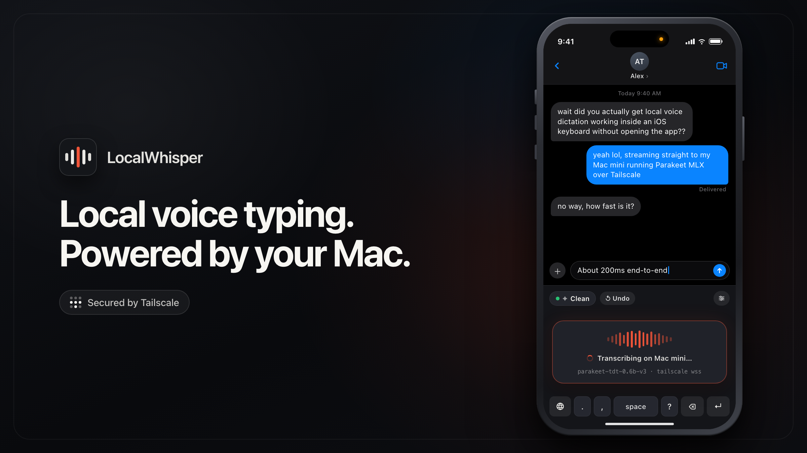

# LocalWhisper



A private, self-hosted, Wispr Flow–style iOS dictation keyboard backed by **NVIDIA Parakeet (`mlx-community/parakeet-tdt-0.6b-v3`)** running on your own Apple Silicon Mac over **Tailscale HTTPS** — with **zero app-switching** inside the keyboard.

## Highlights

- **No app-switching in the keyboard** — records directly inside the custom iOS keyboard extension using the invisible `WKWebView` + `getUserMedia` workaround (with a 1s heartbeat / ~3s dead-man's switch so the microphone always shuts off cleanly if iOS suspends the extension).
- **Sub-250ms local transcription on Apple Silicon** — preloads and keeps `parakeet-tdt-0.6b-v3` warm in unified RAM on your Mac (periodic idle keep-warm prevents overnight macOS swap-out), streams 16 kHz PCM over WebSocket while you talk, and decodes WAV/PCM directly without spawning `ffmpeg`.
- **Wispr Flow–style UX & cleanup** — hybrid tap-to-toggle and press-and-hold dictation, live 24-bar waveform, filler-word removal (`um`, `uh`, stutters), cursor-context capitalization & spacing, personal dictionary replacements, searchable history, and 1-tap Undo.
- **Private by default** — server binds to `127.0.0.1` and is exposed strictly to your Tailnet over HTTPS via `tailscale serve` (optional Bearer token supported).

## Architecture

```text
iPhone (any app)
  └─ LocalWhisper Keyboard Extension
       ├─ Invisible 1×1 WKWebView (alpha 0.01) on https://dictation.local.invalid/
       │    ├─ getUserMedia() -> 16 kHz mono Int16 PCM + live RMS waveform
       │    └─ Dead-man's switch (1s ping, auto-stops tracks after ~3.2s if suspended)
       └─ Streams PCM over WSS (fallback: HTTP WAV) via Tailscale Serve HTTPS
            ↓
Apple Silicon Mac (Mac mini / MacBook)
  └─ FastAPI + parakeet-mlx (preloaded & kept warm in RAM)
       ├─ Zero-ffmpeg fast path for 16 kHz PCM/WAV
       └─ Cleanup pipeline (fillers, stutters, personal dictionary, context spacing)
            ↓
Inserted directly at your cursor with 1-tap Undo
```

## Requirements

- **Mac**: Apple Silicon Mac (M1/M2/M3/M4) running macOS with [uv](https://docs.astral.sh/uv/), `ffmpeg` (`brew install ffmpeg`), [XcodeGen](https://github.com/yonaskolb/XcodeGen) (`brew install xcodegen`), and Xcode.
- **Networking**: [Tailscale](https://tailscale.com/) installed on both your Mac and iPhone (with MagicDNS + HTTPS enabled on your tailnet).
- **iPhone**: iOS 17+ with an Apple Developer account (free or paid) to sign the app and keyboard extension.

## 1. Set Up the Mac Server

The server loads `mlx-community/parakeet-tdt-0.6b-v3` on Apple Silicon MLX, binds to `127.0.0.1:43120`, installs a macOS LaunchAgent (`com.localwhisper.server`), and exposes `/parakeet` over Tailscale HTTPS (`tailnet-only`):

```bash
cd server
./install_service.sh
```

Verify it is live over your Tailnet:

```bash
curl -s https://<your-mac>.ts.net/parakeet/health
```

Run server unit tests:

```bash
cd server && uv run pytest -v
```

### Optional Environment Variables
You can customize the server via environment variables (or in `~/Library/LaunchAgents/com.localwhisper.server.plist`):
- `PARAKEET_MODEL` — Hugging Face MLX model ID (default: `mlx-community/parakeet-tdt-0.6b-v3`)
- `PARAKEET_PORT` — local loopback port (default: `43120`)
- `PARAKEET_API_KEY` — optional Bearer token for `Authorization: Bearer ...`
- `PARAKEET_KEEPWARM_SECONDS` — idle keep-warm interval in seconds (default: `180`; `0` disables)
- `PARAKEET_DEBUG_TEXT` — set to `1` to log transcript contents (off by default)

## 2. Build & Install the iOS App + Keyboard

1. Create your gitignored local signing & server config:

```bash
cp ios/Config/Local.xcconfig.example ios/Config/Local.xcconfig
```

Edit `ios/Config/Local.xcconfig` with your Apple Team ID, bundle ID prefix, and Tailscale server URL:

```xcconfig
DEVELOPMENT_TEAM = YOUR_APPLE_TEAM_ID
BUNDLE_ID_PREFIX = com.yourname
DEFAULT_SERVER_URL = https:/$()/your-mac.tailXXXXX.ts.net/parakeet
```

*(In `.xcconfig` files, write `https://` as `https:/$()/` so `//` is not parsed as a comment.)*

2. Generate the Xcode project and deploy directly to your paired iPhone:

```bash
./ios/deploy_iphone.sh
```

Or open it in Xcode:

```bash
cd ios && xcodegen generate && open LocalWhisper.xcodeproj
```

3. Enable the keyboard on your iPhone:
   - Open **LocalWhisper** and tap **Allow** on **Microphone Permission**.
   - Go to **Settings → General → Keyboard → Keyboards → Add New Keyboard… → LocalWhisper**, then tap **LocalWhisper** and turn on **Allow Full Access**.
   - Make sure **Tailscale** is connected on your iPhone, verify the green **Mac Connected** status badge, and start dictating in any app!

## How the In-Keyboard Mic Workaround Works

iOS blocks custom keyboard extensions from calling `AVAudioEngine` / `AVAudioSession` directly, even with Full Access enabled. LocalWhisper implements the invisible `WKWebView` pattern pioneered by Raycast ([ios/Shared/WebViewAudioRecorder.swift](ios/Shared/WebViewAudioRecorder.swift)):

1. A `1×1 pt`, `alpha = 0.01`, non-interactive `WKWebView` stays mounted in the keyboard's view hierarchy (hidden or detached WebViews get throttled by WebKit).
2. Inline HTML is loaded with an RFC 2606 `https://dictation.local.invalid/` base URL so `navigator.mediaDevices.getUserMedia` runs in a secure context without touching DNS.
3. `WKUIDelegate.webView(_:requestMediaCapturePermissionFor:...)` grants `.microphone` exclusively for `dictation.local.invalid`.
4. JavaScript captures audio, downsamples to 16 kHz mono Int16 PCM, computes live RMS levels for the waveform, and posts chunks back to Swift while streaming them over WebSocket.
5. A **dead-man's switch** pings the WebView every second; if the extension suspends or crashes, JS automatically stops all media tracks within ~3.2 seconds.
6. If Apple ever changes this behavior, a fallback **Dictate in App** action (`localwhisper://dictate`) records natively with `AVAudioEngine` and stages the result via the shared App Group.

## Project Structure

- `server/` — FastAPI + `parakeet-mlx` server (`app.py`, `audio_decode.py`, `postprocess.py`, `install_service.sh`, `tests/`)
- `ios/Config/` — `Base.xcconfig` and `Local.xcconfig.example` (keeps Team IDs & Tailnet URLs out of git)
- `ios/Shared/` — App Group store, WAV encoder, WebSocket + HTTP client, `WebViewAudioRecorder`, `WaveformView`, haptics
- `ios/LocalWhisperKeyboard/` — Custom iOS keyboard extension
- `ios/LocalWhisper/` — Companion iOS app (Setup Checklist, Dictation Playground, History, Personal Dictionary, Settings)

## License

[MIT](LICENSE)
